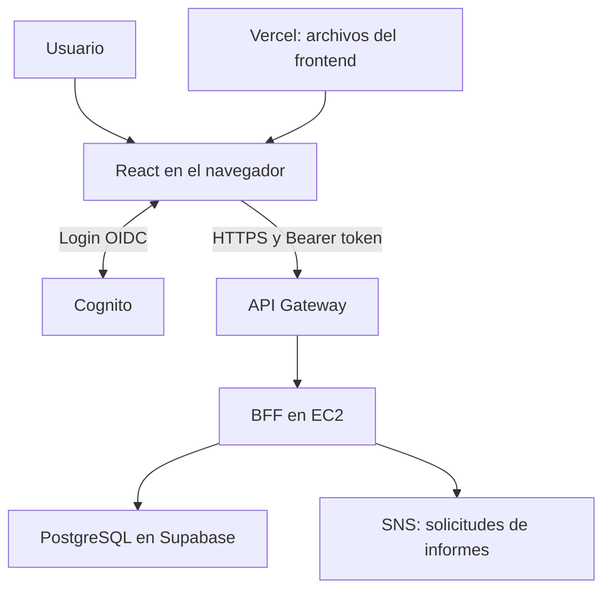

TCGstore — Frontend
Aplicación web de TCGstore para consultar y administrar cartas coleccionables y solicitar informes. Desarrollada con React, TypeScript y Vite. La autenticación se integra con Amazon Cognito y las solicitudes de datos se envían a la API configurada, normalmente AWS API Gateway.
Funcionalidades
- Inicio de sesión con Cognito mediante OpenID Connect y flujo Authorization Code.
- Catálogo con búsqueda y filtros, carrito y vistas de inventario y administración.
- Creación y edición de cartas para Admin y Colaborador; eliminación para Admin.
- Solicitud de informes desde la vista de administración para Admin.
- Rutas protegidas y adaptación de la interfaz según grupos de Cognito.
La autorización definitiva se aplica en el BFF. El carrito es estado del cliente; no se documenta como venta persistida ni como integración de pagos.
Tecnologías
React 19, TypeScript, Vite, React Router, react-oidc-context, oidc-client-ts y API fetch.
Requisitos
- Node.js compatible con las versiones de Vite del proyecto y npm. Se recomienda Node 24 LTS.
- Un User Pool de Cognito, cliente SPA y API configurados para el ambiente elegido.
Instalación y ejecución
Desde la carpeta raíz del frontend, en PowerShell:
npm ci
Copy-Item .env.example .env.local
Edita .env.local con los valores de tu ambiente:
VITE_COGNITO_AUTHORITY=https://cognito-idp.<region>.amazonaws.com/<user-pool-id>
VITE_COGNITO_CLIENT_ID=<client-id>
VITE_API_BASE_URL=https://<api-gateway>
La URL de la API debe ir sin barra final. Configura en Cognito la URL exacta del frontend como callback, por ejemplo http://localhost:5173; revisa también la configuración de cierre de sesión. La API debe permitir el origen mediante CORS.
npm run dev
Abre la URL indicada por Vite, normalmente http://localhost:5173.
Comando	Función
npm run dev	Inicia el servidor de desarrollo.
npm run build	Comprueba TypeScript y genera dist/.
npm run preview	Sirve localmente el build generado.
npm run lint	Ejecuta oxlint.

Configuración en Vercel
Importa el repositorio en Vercel, configura las tres variables VITE_* para el ambiente correspondiente y realiza un nuevo despliegue después de modificarlas: Vite las incorpora al compilar. vercel.json configura la reescritura para las rutas de la SPA. Agrega el origen de Vercel a las callback URLs de Cognito y a CORS del API Gateway.

Las variables VITE_* quedan expuestas en el navegador: no incluyas contraseñas, claves secretas, credenciales de AWS ni el secreto del Gateway.
Comunicación y seguridad
El cliente usa /api/cards para el catálogo y POST /api/informes/generar para solicitar informes. La respuesta 202 indica que la solicitud fue aceptada, no que el informe ya terminó.

En esta versión CardsContext envía access_token y AdminPage envía id_token para informes. Hay que comprobar que el API Gateway y el BFF admitan los tokens enviados, validen el cliente y apliquen los permisos esperados; los scopes no se deben dar por validados solo porque existan en el token. No subas tokens reales a Git.
Estructura
- src/api/: llamadas HTTP para cartas e informes.
- src/components/, src/pages/ y src/layouts/: interfaz.
- src/context/: estado del catálogo y carrito.
- src/hooks/ y src/routes/: roles y protección de rutas.
- src/main.tsx: configuración de Cognito y arranque.
- src/config.ts: dirección base de la API.
Solución de problemas
- Error al iniciar sesión: comprueba issuer, client ID y callback URL en Cognito.
- Error CORS: habilita el origen exacto y los métodos/cabeceras necesarios en API Gateway.
- 401 o 403: revisa token, configuración del authorizer y grupo del usuario; 403 también puede indicar falta de permisos.
- Variables cambiadas en Vercel sin efecto: vuelve a desplegar el frontend.
Arquitectura del cliente

Vercel aloja los archivos compilados; no ejecuta el proceso Java del BFF. React utiliza la URL configurada para llegar al Gateway. El cliente no se conecta directamente a PostgreSQL ni contiene las credenciales de Supabase.
Pantallas y rutas
Ruta	Página	Acceso de interfaz
/	Redirección al catálogo	Usuario autenticado.
/catalogo	Catálogo de cartas	Usuario autenticado.
/inventario	Gestión del inventario	Admin o Colaborador.
/admin	Administración e informes	Admin.
/carrito	Carrito	Cliente.
/no-autorizado	Aviso de permisos insuficientes	Usuario autenticado.

Las rutas desconocidas redirigen al catálogo. App.tsx presenta la pantalla de acceso si no existe autenticación y maneja los estados de carga y error. ProtectedRoute comprueba los roles permitidos para cada ruta.
Roles y responsabilidad de cada capa
Los nombres de grupo son sensibles a su escritura: Admin, Colaborador y Cliente. useUserRoles.ts lee los grupos para adaptar la interfaz. Los guards no añaden automáticamente el token a cualquier petición: las funciones de API reciben el token que sus consumidores les pasan y construyen la cabecera Authorization.

El servidor debe verificar los permisos incluso si el botón no aparece. Para probar un rechazo por rol hay que llamar al endpoint con un token válido del rol que no tiene permiso.
Flujo de inicio de sesión
1. El usuario pulsa el botón de acceso y signinRedirect() inicia la redirección.
2. Cognito presenta el inicio de sesión del User Pool.
3. La aplicación recibe la respuesta en su origen, configurado como redirect_uri.
4. La biblioteca procesa el flujo y la aplicación carga las pantallas autenticadas.
5. El cliente llama a la API con la cabecera Bearer correspondiente.
Los scopes solicitados en main.tsx son email openid phone. El callback limpia los parámetros de autenticación de la URL mediante onSigninCallback. La configuración del proveedor debe corresponder al ambiente local o de Vercel utilizado.
Contratos HTTP utilizados
Operación	Método	Ruta	Resultado esperado del BFF
Listar	GET	/api/cards	200 y lista de cartas.
Crear	POST	/api/cards	201 y carta creada.
Actualizar	PUT	/api/cards/{id}	200 o 404.
Eliminar	DELETE	/api/cards/{id}	204 o 404.
Solicitar informe	POST	/api/informes/generar	202 e identificador.

Modelo de carta de referencia:
{
  "id": "identificador-generado-por-el-servidor",
  "name": "Carta de ejemplo",
  "game": "Pokémon",
  "setName": "Edición de ejemplo",
  "rarity": "Secreta",
  "condition": "Near Mint",
  "price": 100,
  "stock": 3,
  "imageUrl": "https://example.com/carta.png"
}
Los valores son ilustrativos. El alta no necesita enviar id. La API de informes acepta un tipo y parámetros, pero la identidad se obtiene en el servidor a partir del JWT. La confirmación visual de solicitud no demuestra el envío posterior de avisos o correos.
